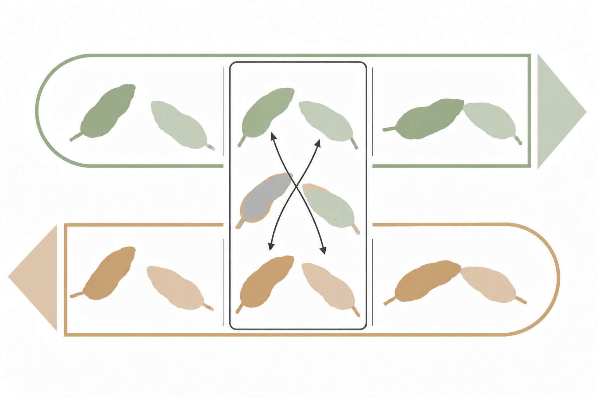
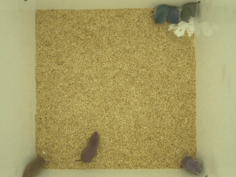

<p align="center">
  
</p>

<h1 align="center">BiVOSIA</h1>

<p align="center">
  <strong>Bidirectional segmentation and identity analysis for animal recordings</strong>
</p>

<p align="center">
  <a href="docs/DOCUMENTATION.md#installation">Get started</a> ·
  <a href="#examples">Examples</a> ·
  <a href="docs/DOCUMENTATION.md">Documentation</a>
</p>

BiVOSIA combines forward and reverse video-object segmentation to help you
track animal identities through social interactions. Review where the two
directions disagree, link identities across the recording, and export masks
for shape analysis and keypoint alignment.

<p align="center">
  
</p>

## From video to analysis

- **Annotate key frames** with manual tools or SAM2/SAM3 point prompts.
- **Track in both directions** with Cutie, locally or on a configured SSH host.
- **Review and link identities** using Zones of Disagreement, then export reviewed masks.
- **Analyze shape and pose** with Zernike features, UMAP and keypoint-to-mask alignment.

The desktop application brings these steps together in a workflow for each
dataset. Individual editors and processing commands can also run separately.

<p align="center">
  
  <br />
  <em>A six-animal recording with reviewed identity masks, shown at 3× speed.</em>
</p>

## Get started

In a Python 3.10+ environment, run these commands from the project folder
(the outer `bivosia/` folder containing `pyproject.toml`):

```bash
python -m pip install -e .
python -m bivosia.run.run_app
```

The editable installation uses the current checkout. For a regular installation,
use `python -m pip install .` instead. After installation, `bivosia` or
`python -m bivosia.run.run_app` starts the app from any directory.

Create or open a dataset, select its video, and open **Workflow**.
[Installation and model setup →](docs/DOCUMENTATION.md#installation)

SAM2 and Cutie can be installed through the application's **Install** action.
SAM3 uses a manually installed package and checkpoint. Models are optional for
manual annotation and for viewing or analyzing existing results.

## Examples

### Label and track a recording

Open the key-frame editor, label and save the crop endpoints, then use VOS to
propagate the masks forward and backward:

```bash
python -m bivosia.run.run_key_frame_editor /path/to/dataset --animals 2 --model sam2
python -m bivosia.run.run_vos /path/to/dataset
```

[Key-frame annotation →](docs/DOCUMENTATION.md#key-frame-annotation) ·
[Video-object segmentation →](docs/DOCUMENTATION.md#video-object-segmentation) ·
[Remote setup →](docs/REMOTE_SETUP.md)

### Review identities and export masks

With forward and reverse masks available, calculate their agreement and open
the revision editor. Review zones, approve identity links and export the result:

```bash
python -m bivosia.run.run_analysis quantify /path/to/dataset --n-animals 2
python -m bivosia.run.run_zone_revision /path/to/dataset
```

[Zone review, identity linking and export →](docs/DOCUMENTATION.md#zone-review-identity-linking-and-export)

### Explore shape and align keypoints

From **Workflow → Mask features**, analyze a reviewed consensus export to
calculate Zernike descriptors and visualize them with UMAP. Mask preprocessing
and feature z-scoring are optional. Open **Keypoint alignment** to assign pose
tracks to mask identities; SLEAP analysis files are supported.

[Mask features and UMAP →](docs/DOCUMENTATION.md#mask-features-and-umap) ·
[Keypoint alignment →](docs/DOCUMENTATION.md#keypoint-alignment)

Use your recording's animal count in place of `2` in the examples.
See the guide for [data formats and storage](docs/DOCUMENTATION.md#data-formats-and-storage)
and [batch processing](docs/DOCUMENTATION.md#command-line-examples-and-batch-processing).

## Authors

**BiVOSIA software:** Kara Quine, Shuyu Wang and Christoph Kirst.

Contact: [christoph.kirst@ucsf.edu](mailto:christoph.kirst@ucsf.edu)

[Code and development](docs/DOCUMENTATION.md#code-and-development) ·
[Implementation notes](docs/IMPLEMENTATION.md)

## Paper

Shuyu Wang, Kara Quine, Audrey Jordan, Shreya Dasari, Devanand S. Manoli and Christoph Kirst.
**Identity-stable multi-animal tracking using bidirectional segmentation with object-level memory.**
*bioRxiv* (2025), preprint. [Read the paper](https://www.biorxiv.org/content/10.1101/2025.09.22.677949v1) ·
[DOI: 10.1101/2025.09.22.677949](https://doi.org/10.1101/2025.09.22.677949)

## License

BiVOSIA is licensed under [GPL-3.0-only](LICENSE). Third-party software and model
weights retain their own licenses.
